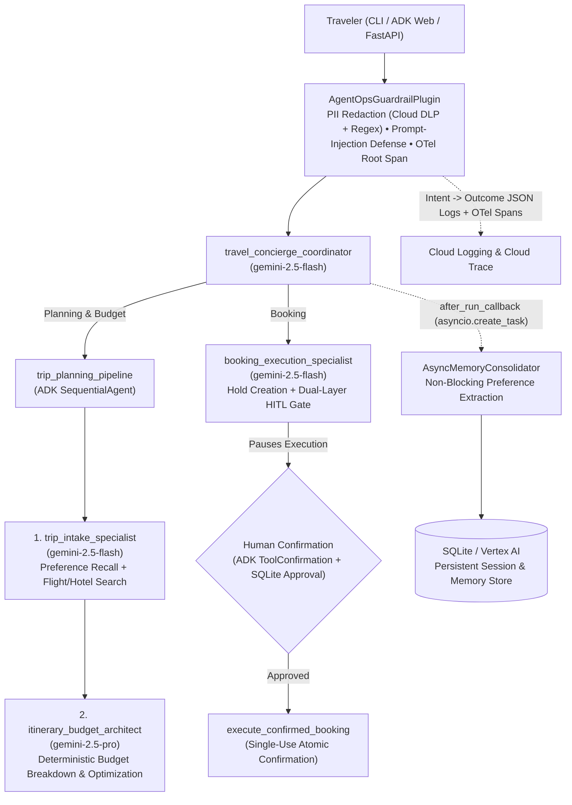

# Smart Travel & Trip Budget Concierge Agent (Google ADK-Python)

A production-oriented, multi-agent **Concierge AI Agent** built with **Google Agent Development Kit (ADK-Python)** that plans budget-disciplined trips, remembers traveler preferences asynchronously, actively scrubs PII across LLM/logging/memory boundaries, enforces deterministic budget & prompt-injection guardrails, traces every step with OpenTelemetry, and pauses for **Human-in-the-Loop (HITL)** confirmation before executing any booking.

---

## Architecture Overview



---

## AgentOps Code Review Matrix (19/19 Traceability)

| Category | Rubric Criterion | Code Evidence in This Repository |
|---|---|---|
| **1. Tool & Interface Design** | **Comprehensive Tool Docstrings** | All 7 tools in `travel_concierge/tools/travel_tools.py` include detailed Google-style docstrings covering purpose, every parameter, return schema, and recovery behavior (enforced by automated unit test in `tests/test_tools_and_schemas.py`). |
| | **Descriptive Naming** | Action-specific verb-noun tools: `search_budget_flights`, `search_hotels_within_budget`, `calculate_trip_budget_breakdown`, `save_traveler_preference`, `recall_traveler_preferences`, `request_booking_approval`, `execute_confirmed_booking`. |
| | **Explicit JSON Schemas** | Strict Pydantic v2 input/output schemas in `travel_concierge/schemas.py` (`ConfigDict(extra="forbid")`, IATA regex, chronological date checks, bounded budgets/travelers). |
| | **Guided Error Handling** | Every tool catches validation/inventory/policy errors and returns `StructuredToolError` (`error_code`, `recovery_instructions`, `suggested_next_tool`, `retryable`), backed by `AgentOpsGuardrailPlugin.on_tool_error_callback`. |
| **2. Context & Memory** | **Robust System Instructions** | Versioned Travel Concierge Constitution (`GLOBAL_CONCIERGE_CONSTITUTION`) + specialist role constitutions in `travel_concierge/prompts.py`. |
| | **History Compaction** | `SlidingWindowEventSummarizer(BaseEventsSummarizer)` wired into ADK `App(events_compaction_config=EventsCompactionConfig(...), context_cache_config=...)` in `travel_concierge/memory/compaction.py`. |
| | **Persistent Session State** | ADK `SqliteSessionService` + `PersistentTravelStore` (parameterized SQLite) locally, switchable via `AGENT_STORAGE_BACKEND=vertex` to `VertexAiSessionService` & `VertexAiMemoryBankService` in `travel_concierge/memory/store.py`. |
| | **Async Memory Operations** | `AsyncMemoryConsolidator` in `travel_concierge/memory/async_memory.py` dispatches preference extraction and session consolidation via non-blocking `asyncio.create_task()` in `after_run_callback` and `save_traveler_preference`. |
| **3. Orchestration & Logic** | **Multi-Agent Patterns** | ADK Coordinator (`travel_concierge_coordinator`) delegating to a `SequentialAgent` (`trip_planning_pipeline`: `trip_intake_specialist` -> `itinerary_budget_architect`) and `booking_execution_specialist` in `travel_concierge/agent.py`. |
| | **Strategic Model Routing** | `ModelRoutingConfig` in `travel_concierge/config/settings.py` routes fast intake, routing, and booking execution to `gemini-2.5-flash` and complex multi-constraint itinerary/budget optimization to `gemini-2.5-pro`. |
| | **Guardrails & Policy Plugins** | `AgentOpsGuardrailPlugin(BasePlugin)` in `travel_concierge/security/guardrails.py` enforces prompt-injection containment, hard budget caps, PII scrubbing, and post-model **self-evaluation** (`after_model_callback` catching unverified booking claims). |
| | **Human-in-the-Loop Hooks** | Dual-layer fail-closed HITL: ADK `FunctionTool(execute_confirmed_booking, require_confirmation=True)` + `tool_context.request_confirmation(...)` + `ResumabilityConfig(is_resumable=True)` + single-use SQLite approval token bound to SHA-256 quote fingerprint. |
| **4. Observability & Tracing** | **Structured JSON Logging** | `StructuredAgentLogger` + `JsonLogFormatter` in `travel_concierge/observability/logging.py` emitting single-line JSON correlated with `trace_id`/`span_id` (zero raw `print()` in runtime code). |
| | **Intent vs. Outcome Capture** | Explicit `agent.intent` logs & span events emitted BEFORE model/tool execution and `agent.outcome` logs & span events emitted AFTER execution with latency & status in `travel_concierge/security/guardrails.py`. |
| | **Distributed Tracing** | OpenTelemetry `TracerProvider` in `travel_concierge/observability/telemetry.py` linking root invocation -> agent delegation -> LLM inference -> tool call spans (Cloud Trace exporter ready via `OTEL_EXPORT_CLOUD_TRACE=true`). |
| | **PII Redaction** | `PIIRedactor` in `travel_concierge/security/pii_redactor.py` supporting Google Cloud DLP (`google-cloud-dlp`) + deterministic Luhn/regex local scrubbing across ingress, logs, memory, and compaction. |
| **5. Infrastructure & CI/CD** | **Automated Evaluation Suites** | ADK `EvalSet` golden dataset (`evals/travel_concierge.evalset.json`), `evals/eval_config.json`, `evals/eval_config.yaml`, automated regression harness (`evals/test_golden_evals.py`), and GitHub Actions CI (`.github/workflows/ci.yml`). |
| | **Infrastructure as Code** | Complete Terraform configuration in `infra/terraform/` (GCP APIs, least-privilege SA, Secret Manager, Artifact Registry, GCS Agent Runtime staging bucket, Cloud Run v2) + `Dockerfile`, `Makefile`, and `agents-cli` / `adk deploy` docs. |
| | **Secure Secret Management** | `SecretProvider` in `travel_concierge/config/secrets.py` using Google Cloud Secret Manager (`google-cloud-secret-manager`) or explicit env vars with zero hardcoded keys or literal fallbacks, plus `.semgrep/rules.yaml`. |

---

## Project Structure

```text
smart-travel-concierge-agent/
├── travel_concierge/
│   ├── __init__.py              # Exports ADK `app` and `root_agent`
│   ├── agent.py                 # Multi-agent ADK topology, model routing & App wiring
│   ├── app_server.py            # FastAPI wrapper (/health, /chat, /approvals/{id}/decision)
│   ├── prompts.py               # Constitutional global & specialist system instructions
│   ├── schemas.py               # Strict Pydantic v2 tool input/output & error schemas
│   ├── config/
│   │   ├── settings.py          # Env-driven runtime config & strategic ModelRoutingConfig
│   │   └── secrets.py           # SecretProvider (Google Cloud Secret Manager + fail-closed env)
│   ├── memory/
│   │   ├── store.py             # Parameterized SQLite store + ADK Session/Memory factories
│   │   ├── compaction.py        # ADK SlidingWindowEventSummarizer & EventsCompactionConfig
│   │   └── async_memory.py      # Non-blocking asyncio background preference consolidation
│   ├── observability/
│   │   ├── logging.py           # Structured JSON logger with PII scrubbing & Intent/Outcome helpers
│   │   └── telemetry.py         # OpenTelemetry distributed tracing & Cloud Trace integration
│   ├── security/
│   │   ├── pii_redactor.py      # Google Cloud DLP + deterministic Luhn/regex PII scrubber
│   │   └── guardrails.py        # ADK BasePlugin: injection defense, policy caps, self-eval, tracing
│   └── tools/
│       ├── catalog.py           # Synthetic flight & hotel inventory for reproducible demos/tests
│       └── travel_tools.py      # 7 schema-validated, docstringed ADK tools + HITL gate
├── tests/                       # Comprehensive offline pytest unit & integration tests
├── evals/                       # ADK EvalSet golden dataset, configs & automated regression suite
├── infra/terraform/             # Production GCP Terraform IaC (APIs, IAM, Secret Manager, Cloud Run)
├── docs/SECURITY.md             # STRIDE Threat Model & automated security verification plan
├── .semgrep/rules.yaml          # Custom static rules (API key, print(), SQL f-string checks)
├── .github/workflows/ci.yml     # CI pipeline (ruff, pytest, golden evals, terraform validate)
├── Dockerfile                   # Non-root Python 3.13 container using uv
├── Makefile                     # Developer & deployment targets
└── pyproject.toml               # uv / Hatchling project metadata & dependencies
```

---

## Quick Start (Local Development & Verification)

### 1. Prerequisites
- Python 3.11+ (tested on Python 3.13)
- [`uv`](https://docs.astral.sh/uv/) package manager

### 2. Install Dependencies
```bash
uv sync --extra dev
```

### 3. Run Offline Unit Tests & Golden Evaluation Suite (No API Key Required)
```bash
make test
make eval
make lint
```

### 4. Run the Interactive ADK Dev UI (`adk web`) or `agents-cli` Playground
Copy `.env.example` to `.env` and export your Gemini API key locally (or configure Vertex AI ADC):
```bash
cp .env.example .env
export GEMINI_API_KEY="your-local-api-key"

# Option A: Google ADK Web UI (binds strictly to 127.0.0.1:8080)
make playground

# Option B: Agents CLI local playground
uvx google-agents-cli setup
agents-cli playground

# Option C: Standalone FastAPI service with HITL approval endpoint
make serve
```

### 5. Run Live LLM Evaluations (`adk eval` / `agents-cli`)
```bash
# Run ADK golden dataset evaluation against live Gemini models
make eval-live

# Or grade traces with agents-cli custom LLM-as-judge rubrics (evals/eval_config.yaml)
agents-cli eval --config evals/eval_config.yaml
```

---

## Production Deployment on Google Cloud

### Option A: Terraform IaC (APIs, IAM, Secret Manager, Artifact Registry, Cloud Run)
```bash
cd infra/terraform
cp terraform.tfvars.example terraform.tfvars
# Edit terraform.tfvars with your GCP project_id and region

terraform init
terraform validate
terraform plan
terraform apply

# Populate the Gemini API key out-of-band (only if not using Vertex AI ADC)
printf '%s' "$GEMINI_API_KEY" | gcloud secrets versions add smart-travel-concierge-gemini-api-key --data-file=-
```

### Option B: Vertex AI Agent Runtime via `agents-cli` or `adk deploy`
```bash
# Lock dependencies and run a deployment dry-run
uv lock
agents-cli deploy --dry-run

# Deploy to managed Vertex AI Agent Runtime
export GOOGLE_CLOUD_PROJECT="your-gcp-project-id"
export GOOGLE_CLOUD_LOCATION="us-central1"
agents-cli deploy --project "$GOOGLE_CLOUD_PROJECT" --region "$GOOGLE_CLOUD_LOCATION"

# Or deploy directly via ADK CLI
uv run adk deploy agent_engine \
  --project "$GOOGLE_CLOUD_PROJECT" \
  --region "$GOOGLE_CLOUD_LOCATION" \
  --staging_bucket "gs://${GOOGLE_CLOUD_PROJECT}-smart-travel-concierge-staging" \
  travel_concierge
```

---

## Security & Privacy Highlights

See [`docs/SECURITY.md`](docs/SECURITY.md) for the full STRIDE threat model and automated verification plan:
- **Zero hardcoded secrets**: All credentials flow through `SecretProvider` (Google Cloud Secret Manager or explicit environment variables).
- **Defense-in-depth PII scrubbing**: Credit cards (Luhn-checked), passports, SSNs, emails, phone numbers, and DOBs are scrubbed before LLM calls, JSON logs, compaction summaries, and SQLite memory writes.
- **Fail-closed Human-in-the-Loop**: `execute_confirmed_booking` refuses execution unless both ADK `ToolConfirmation` and a matching, unexpired, single-use SQLite approval record exist.
